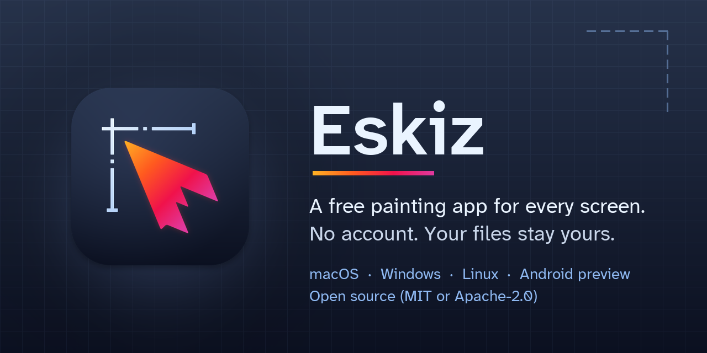

<p align="center">
  
</p>

<p align="center">
  <a href="https://github.com/evarnimtb-netizen/eskiz-app/releases"><b>Download Eskiz</b></a>
  &nbsp;·&nbsp;
  <a href="https://github.com/evarnimtb-netizen/eskiz-app/issues/new?template=bug_report.yml"><b>Report a bug</b></a>
  &nbsp;·&nbsp;
  <a href="https://github.com/evarnimtb-netizen/eskiz-app/discussions"><b>Ask a question</b></a>
</p>

**Eskiz** is a free painting and drawing app for your computer. Sketch, paint and animate with layers, many brushes, pen pressure, selections, text, drawing guides and simple frame-by-frame animation. It opens and saves `.procreate` files, and exports PNG, JPEG, PSD, GIF and more.

- **Free, with no account and no ads.** Eskiz does not collect any data. Your drawings stay on your computer.
- **Works on** Mac, Windows and Linux. An early Android version is available too.

> **This is the first preview (version 0.1.0).** Most things work, but you may find bugs. Please [tell us](#found-a-bug) when something goes wrong; it really helps.

## Download and install

1. Open the **[Downloads page](https://github.com/evarnimtb-netizen/eskiz-app/releases)** and pick the newest release at the top.
2. Under **Assets**, click the file for your computer:

   | Your computer | File to download |
   |---|---|
   | Mac (any Mac from the last ten years) | `Eskiz-…-macos-universal.dmg` |
   | Windows 10 or 11 | `Eskiz-…-windows-x64.zip` |
   | Linux | `Eskiz-…-x86_64.AppImage` |
   | Android 10 or newer (early preview) | `Eskiz-…-android-arm64-experimental.apk` |

3. Follow the steps for your system below.

**Why does my computer warn me?** Big companies pay every year for a certificate that stops these warnings. Eskiz is a free volunteer project without one, so your system asks you to confirm the first time you open it. That is expected. Only download Eskiz from this page.

### Mac

1. Double-click the downloaded `.dmg` file. A window opens.
2. Drag the **Eskiz** icon onto the **Applications** folder.
3. Open your **Applications** folder, **right-click** (or Control-click) **Eskiz** and choose **Open**.
4. macOS asks if you are sure: click **Open**. You only need to do this once.

If macOS still will not open it: open **System Settings → Privacy & Security**, scroll down and click **Open Anyway** next to the message about Eskiz.

### Windows

1. Find the downloaded `.zip` file (usually in **Downloads**), right-click it and choose **Extract All…**, then **Extract**.
2. Open the new **Eskiz** folder and double-click **eskiz.exe**.
3. If a blue window says **"Windows protected your PC"**, click **More info**, then **Run anyway**. You only need to do this once.

Tip: to start Eskiz more easily, right-click `eskiz.exe` and choose **Pin to Start** or **Send to → Desktop (create shortcut)**.

If nothing happens or an error appears, see [Something does not start](#something-does-not-start).

### Linux

1. Right-click the downloaded `.AppImage` file, choose **Properties → Permissions** and tick **Allow executing file as program** (or run `chmod +x Eskiz-*.AppImage` in a terminal).
2. Double-click it to start Eskiz.

If Eskiz says a graphics library is missing, it tells you which package to install. A `.tar.gz` package with an `install.sh` script is also on the Downloads page.

### Android (early preview)

1. Download the `.apk` file on your phone or tablet and open it.
2. If asked, allow your browser or file app to install apps, then tap **Install**.

The Android version is experimental: saving to other apps, sharing and the clipboard are not there yet.

## Found a bug?

**[Click here to report a bug](https://github.com/evarnimtb-netizen/eskiz-app/issues/new?template=bug_report.yml).** A short form opens; fill in what you can. It helps a lot to include:

- what you did, what happened, and what you expected;
- your system (for example "Mac, macOS 15" or "Windows 10 laptop");
- a screenshot, if you can.

You need a free GitHub account to send the form. Have a question or an idea instead? [Ask in Discussions](https://github.com/evarnimtb-netizen/eskiz-app/discussions). Found a security problem? Please report it privately as described in [SECURITY.md](SECURITY.md).

### Something does not start

- **Windows:** Eskiz writes notes about its start-up to a folder. Press **Windows key + R**, paste `%LOCALAPPDATA%\Eskiz\logs`, press **Enter**, and attach the files you find there (`startup.log` and any `panic-…txt`) to your bug report.
- **Windows, the window freezes or says "Not Responding":** close it and start Eskiz again; it skips the graphics renderer that froze and says so. To choose by hand, double-click **Eskiz (compatibility mode).bat** in the zip, or run `eskiz.exe --renderer gl` (also `dx12`, `vulkan` or `auto`), or turn on **Settings → Graphics → Compatibility graphics (OpenGL)** and restart. Then attach `startup.log` to your bug report: it contains a `STALL:` line saying where it hung.
- **Any system:** in Eskiz's folder, running `eskiz --diagnose` from a terminal prints a short report about your graphics setup that you can paste into the bug report.

## Good to know

- **Files:** Eskiz saves your drawings in its own gallery. Use **Share** to export them as PNG, JPEG, PSD, `.procreate`, GIF and other formats.
- **Not in this version:** MP4 video export (GIF and APNG animations work).
- **Independent project:** Eskiz is not affiliated with or endorsed by the makers of any other app. `.procreate` files are supported only for compatibility.
- **Privacy:** Eskiz collects nothing and needs no internet connection. Details in [PRIVACY.md](PRIVACY.md).
- **Support:** Eskiz is free and always will be. A way to donate may be added here later; donating will never unlock features.

<!-- Donation link placeholder: add it here (and in .github/FUNDING.yml) when the maintainer has an account. -->

---

## For developers

### Build from source

You need the Rust toolchain installer, [rustup](https://rustup.rs). The right Rust version is picked from `rust-toolchain.toml`.

```
git clone https://github.com/evarnimtb-netizen/eskiz-app.git
cd eskiz-app
cargo run --release -p eskiz-app
```

On Linux, install the development libraries first (Debian or Ubuntu names):

```
sudo apt-get install libxkbcommon-dev libxkbcommon-x11-0 libgl1-mesa-dev libwayland-dev \
  libx11-dev libxcursor-dev libxrandr-dev libxi-dev fonts-dejavu-core mesa-vulkan-drivers
```

Run the checks that CI runs:

```
cargo test --workspace --locked
cargo clippy --workspace --all-targets --locked -- -D warnings
cargo build --release -p eskiz-app --locked
./target/release/eskiz --selftest
```

Packaging scripts for each platform are in `packaging/`, and the Android project is in `android/`. `INTEGRATION.md` explains how the crates fit together. Downloads come with a `SHA256SUMS` file if you want to check them.

### Contributing

Bug reports, feature ideas and patches are welcome. Read [CONTRIBUTING.md](CONTRIBUTING.md) first; contributions need a DCO sign-off. Everyone taking part follows the [Code of Conduct](CODE_OF_CONDUCT.md).

### License

Licensed under either of [MIT](LICENSE-MIT) or [Apache-2.0](LICENSE-APACHE), at your option. Third-party notices are in `THIRD_PARTY_NOTICES.md` and are included in every package.

MP4 export uses the OpenH264 codec. Cisco's binary builds of OpenH264 come with a patent license that applies only to the unmodified binary downloaded from Cisco. A copy compiled from source does not carry that license, so distributed builds ship without MP4 export. Developers can enable it with `--features mp4` and are responsible for any codec licensing that applies to them.
